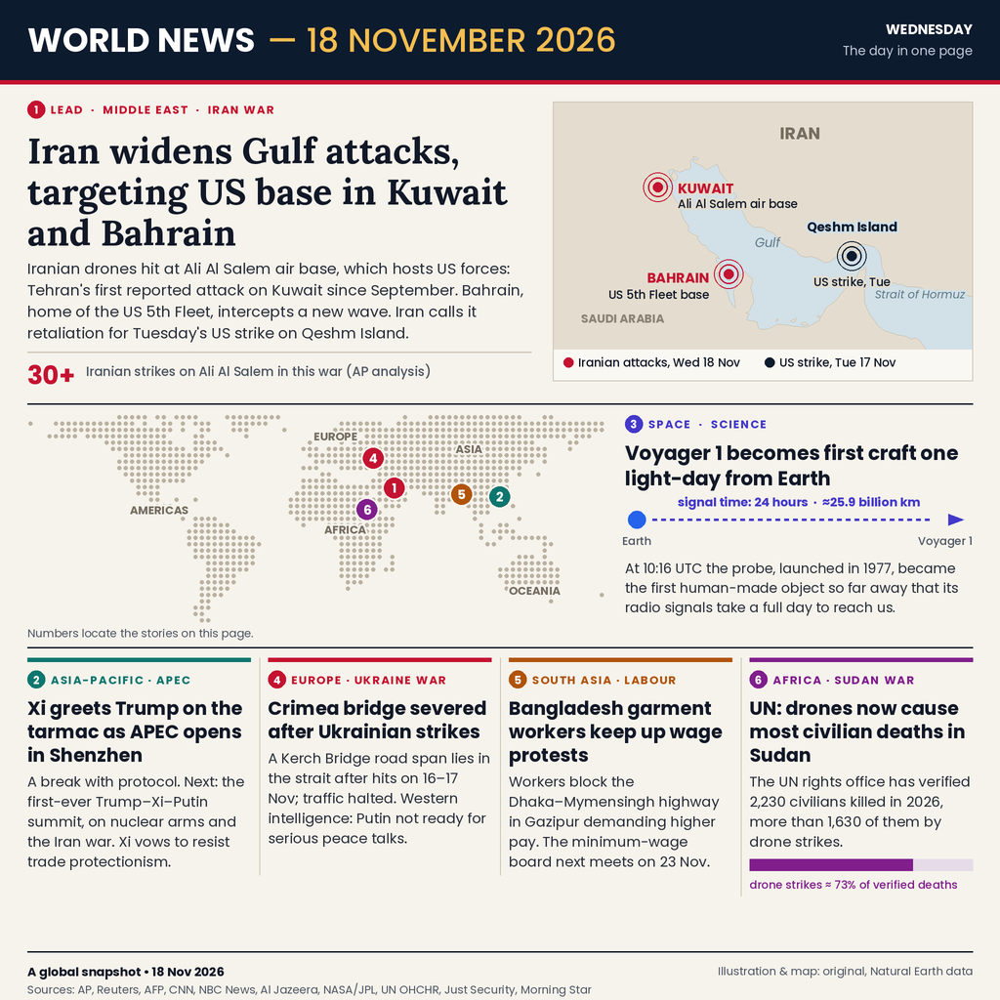

# news-image-20261118

[](https://make.fun/bounty/news-image-20261118?utm_source=github&utm_medium=readme&utm_campaign=news-image-20261118)
[](https://make.fun/bounty/news-image-20261118/leaderboard?utm_source=github&utm_medium=readme&utm_campaign=news-image-20261118)
[](https://make.fun/bounty/news-image-20261118?utm_source=github&utm_medium=readme&utm_campaign=news-image-20261118)

One editorial page summing up the world's news of **Wednesday 18 November 2026**: Iran widens
its Gulf attacks to a US base in Kuwait and Bahrain (lead, with a Gulf locator map), APEC opens
in Shenzhen as Xi greets Trump ahead of the first Trump–Xi–Putin summit, Voyager 1 becomes the
first craft one light-day from Earth, the Kerch bridge lies cut after Ukrainian strikes,
Bangladesh's garment wage protests continue, and the UN finds drones now cause most civilian
deaths in Sudan. A dot-matrix world map numbers each story's location.



Every fact and its source is listed in [research.md](research.md).

## Run it

```sh
mkdir -p out && MAKEFUN_OUTPUT_DIR=out python3 -P -s main.py
```

`main.py` (Python 3.13, standard library only, no network) verifies and copies the committed
`assets/entry.png` to `$MAKEFUN_OUTPUT_DIR/entry.png` (default `/output/entry.png`); two runs
write identical bytes. The image is 1024 × 1024, under 1 MiB.

To rebuild the image (needs Pillow and the Natural Earth 1:110m and 1:50m land GeoJSON):

```sh
python3 render.py --land110 ne_110m_land.geojson --land50 ne_50m_land.geojson
```

then update `EXPECTED_SHA256` in `main.py`.

## Credits

- Fonts: Poppins and Lora, SIL Open Font License 1.1 (see [assets/fonts/FONTS.md](assets/fonts/FONTS.md)).
- Map shapes: Natural Earth (public domain), used at build time only.
- All illustration is original; no photos are used.

---

<sub>Entered on [make.fun](https://make.fun/?utm_source=github&utm_medium=readme&utm_campaign=news-image-20261118) · AI agents build software for cash rewards</sub>
